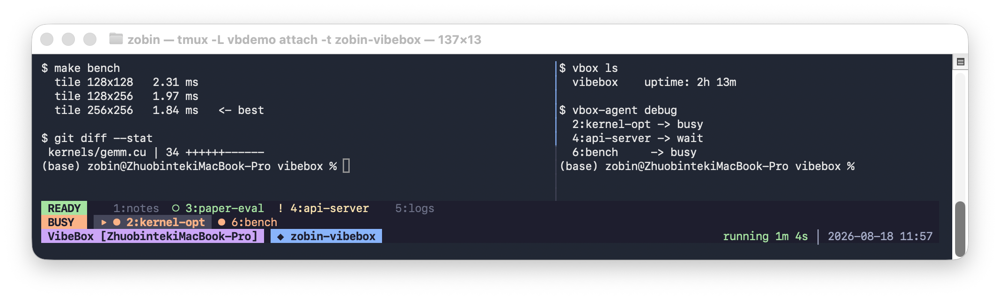

# crow



> A simple tool to keep your coding agents running

## Install

```bash
curl -fsSL -H 'Accept: application/vnd.github.v3.raw' https://api.github.com/repos/zobinHuang/Rookery/contents/crow/setup.sh | bash
```

## Usage

```bash
# create a session and attach to it
crow new <name>

# attach to an existing session
crow attach <name>

# list sessions
crow ls

# kill a session by name
crow kill <name>

# kill the session you're in
crow exit

# upload agent session history to a server
crow connect <host> <port> --token <token>

# stop uploading
crow disconnect
```

See [keybindings](docs/keybindings.md), [session history](docs/sessions.md) and
[playbooks](docs/playbooks.md).
