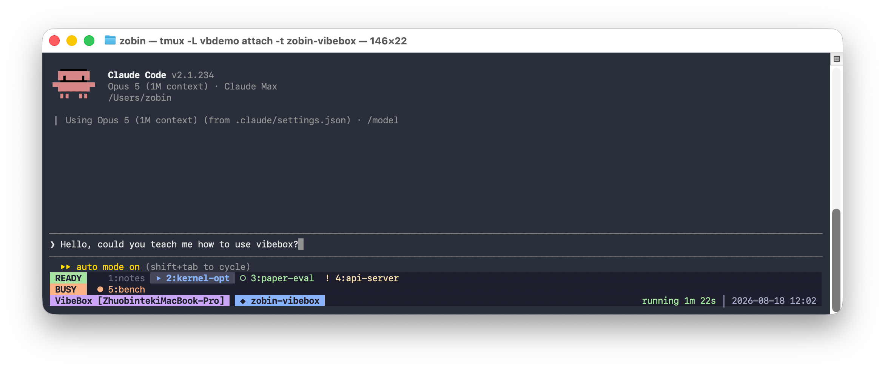

# rook



> A simple tool to keep your coding agents running

## Install

```bash
curl -fsSL -H 'Accept: application/vnd.github.v3.raw' https://api.github.com/repos/zobinHuang/Rookery/contents/rook/setup.sh | bash

# or name this machine's agents up front (they go by <name>/<tab>)
curl -fsSL -H 'Accept: application/vnd.github.v3.raw' https://api.github.com/repos/zobinHuang/Rookery/contents/rook/setup.sh | bash -s -- --name studio
```

## Usage

```bash
# create a session and attach to it
rook new <name>

# attach to an existing session
rook attach <name>

# list sessions
rook ls

# kill a session by name
rook kill <name>

# kill the session you're in
rook exit

# upload agent session history to a server
rook connect <host> <port> --token <token>

# stop uploading
rook disconnect

# read and change the server's agents, skills, playbooks and memories
rook resource ls --kind agent
rook resource get playbook backend-review
rook resource update memory <id> --attr text="use cursors, not offsets"
```

Once connected, every agent session also reports what it is doing, and what it does to skills, playbooks
and memory, to the server as it works; see [resources](../docs/resources.md).

See [keybindings](docs/keybindings.md), [session history](docs/sessions.md) and
[playbooks](docs/playbooks.md).
